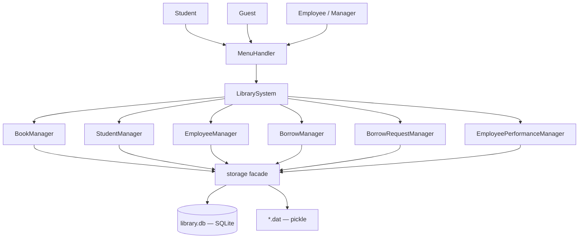

# ap — University Library Management System

A console-based university library management system built in both **Java** and
**Python** for the Advanced Programming course. The repository also holds the
weekly lab exercises and exam solutions completed during the term.

Four roles use the system: guests can browse, students request and track borrows,
employees run the day-to-day desk operations, and the manager oversees staff and
statistics.

## Features

### Student

- Register and log in with a student account, view and edit profile information
- Search books by title/author/year and browse available copies
- Submit borrow requests with a desired start and end date
- Track borrow requests and full personal borrow history

### Guest

- View live library statistics (students, books, borrows)
- Search books by title without an account

### Employee

- Add, search, and edit books in the catalog
- Approve or reject student borrow requests with a reason
- Lend approved books (record pickup) and receive returns (record return time)
- Generate per-student borrow reports; activate or deactivate student accounts
- View personal performance report and change password

### Manager

- Everything an employee can do, plus:
- Register new employees and view the full staff list
- View all employees' performance reports
- Inspect borrow statistics (approval/rejection, overdue, completion rates)
- Inspect student statistics and the top 10 students with the most late books

## Running

### Java version (`ap/projects/finalproject/`)

Requires JDK 8+. No external dependencies.

```bash
javac -d out ap/projects/finalproject/*.java
java -cp out ap.projects.finalproject.LibrarySystem
```

### Python version (`ap/projects/finalproject_python/`)

Requires Python 3.8+. No external dependencies — `sqlite3` ships with Python.
Data is persisted to a SQLite database (`library.db`) by default; the storage
backend can be switched to the original pickle `*.dat` files via
`storage_config.json` (see the [Python README](ap/projects/finalproject_python/README.md)).

```bash
cd ap/projects/finalproject_python
python main.py
```

### Default accounts

Created automatically on first run of either version:

| Role    | Username | Password |
|---------|----------|----------|
| Manager | `admin`  | `1234`   |
| Staff   | `staff`  | `1234`   |

## Structure

```
ap/
├── exercises/
│   ├── ex2/                 # lab 2 — console patterns & Pacman game engine
│   ├── ex3/                 # lab 3 — classes & objects
│   ├── ex4/                 # lab 4 — objects-early exercises
│   ├── EX7/                 # storage abstraction: tabsplit / json / sqlite backends
│   ├── midtermExam/         # midterm exam solutions
│   ├── FinalExam/           # final exam solutions
│   ├── MidtermProj/         # midterm project — console library manager
│   └── projects/            # web tools — domain scraper, HTML parser, media downloader
└── projects/
    ├── finalproject/        # Library Management System (Java)
    │   ├── LibrarySystem    # entry point & application core
    │   ├── MenuHandler      # role-based console menus
    │   ├── *Manager         # business logic per entity
    │   ├── *FileManager     # Java-serialized *.dat persistence
    │   └── models           # Book, Student, Employee, BorrowRecord, ...
    └── finalproject_python/ # same system in Python
        ├── main / library_system / menu_handler
        ├── *_manager        # business logic per entity
        ├── storage          # backend facade: SQLite (default) or pickle
        ├── database / sqlite_storage
        └── models           # one module per Java model class
```

## Architecture

### Data flow



### Layers

- **UI layer** — `MenuHandler` renders role-based console menus and collects input
- **Application layer** — `LibrarySystem` owns session state, permission guards, and use-case orchestration
- **Business layer** — one manager class per entity holds validation rules and workflows
- **Persistence layer** — the `storage.py` facade dispatches to SQLite (default) or pickle; in Java, `*FileManager` classes serialize `*.dat` files
- **Domain models** — plain data classes shared by every layer, kept in one-to-one correspondence between the Java and Python versions

## Notes

- The Java version persists with Java serialization; the Python version persists to SQLite through `sqlite_storage.py`, with the pickle `*.dat` backend selectable in `storage_config.json` — the managers never touch the backend directly.
- Passwords are stored in plain text in both versions. This is an educational project; do not reuse any of it for real systems.
- The `exercises/` folders are the weekly coursework (labs, exams, and a domain-scraping tools project) and are independent of the two final project implementations.
- Both versions have zero third-party dependencies: JDK 8+ for Java, Python 3.8+ (standard library only) for Python.
